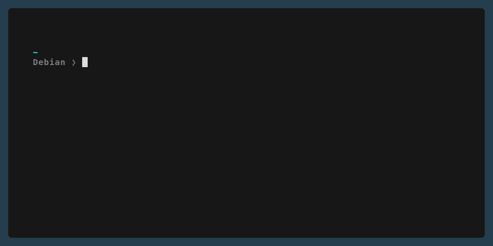

# MyStarship-Theme

## Features

- **OS name display** - cool with grey color
- **Sudo indicator** - `as 🧙`
- **No Runtime Versions mixed with Pure preset style** - based on "no-runtime-versions" and "pure-prompt" presets
- **Never show USERNAME or HOSTNAME** beside the current location


## ⚙️ Requirements

[Starship](https://starship.rs/guide/#%F0%9F%9A%80-installation)


---

## 📦 Installation 

```bash
curl -o ~/.config/starship.toml https://raw.githubusercontent.com/FladioGelo/MyStarship-Theme/main/starship.toml
```

---
## 📸 Preview

<details open>
<summary><b>As sudo</b></summary>



</details>

<details open>
<summary><b>In projects</b></summary>


</details>
---

---

## 📄 License

MIT — free to use, fork, and customize.
